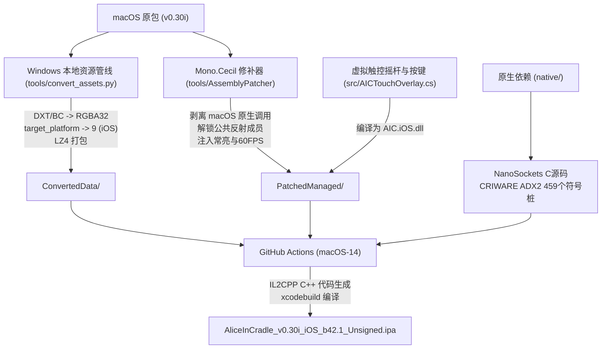

# Alice in Cradle (iOS Port)

本项目为《Alice in Cradle》（v0.30i）移植至 iOS 平台的完整移植工程与自动化构建流水线。

通过在 Windows 环境下完成全部资源转码、程序集修补与触控映射，结合 GitHub Actions（macOS 运行环境）自动拉取 Unity 2022.3.62f2 iOS 运行时，免除 Unity 商业授权限制，一键编译并打包未签名 iOS `.ipa`。

---

## 🛠️ 移植架构与技术方案



### 1. 资源转换管线 (`tools/convert_assets.py`)
- **纹理格式转码**：扫描全游戏 3081 个资源文件中的 281 张纹理，将 94 张移动端不支持的桌面压缩纹理（DXT1、DXT5、DXT1Crunched、DXT5Crunched）全自动无损转换为 `RGBA32`，保证 2D 像素画质与平滑渲染。
- **序列化平台标识**：将所有 409 个 `.dat` AssetBundles 及核心文件（`globalgamemanagers`、`resources.assets`、`level0`~`level3`、`sharedassets0`~`3`）的 `target_platform` 与 `_m_target_platform` 完整修改为 `BuildTarget.iOS` (9)。
- **StreamData 清理与 LZ4 压缩**：清除转码纹理的 `m_StreamData` 引用，清理冗余的 `.resS` 分离块，并启用 LZ4 压缩重新封包。

### 2. 托管代码修补 (`tools/AssemblyPatcher`)
- **中和 macOS 原生 P/Invoke**：
  - `unsafeAssem.dll`：清除 `XX.MacGamepadHaptics`（震动马达 6 处调用），安全替换为托管返回值。
  - `SFB.dll`：清除 `SFB.StandaloneFileBrowserMac`（文件选择框 6 处调用）。
  - `CriMw.CriWare.Runtime.dll`：绕过 `CriWare.Common::CheckBinaryVersionCompatibility` 严格版本校验。
- **游戏循环与功耗优化**：
  - 在 `XX.IN::Awake()` 注入 `Screen.sleepTimeout = -1`（防止触屏无物理键输入时熄屏）。
  - 解锁 `XX.IN`、`XX.KEY` 的访问权限为 `public`，供触控层直接注入指令。

### 3. iOS 虚拟触控层 (`src/AICTouchOverlay.cs` -> `AIC.iOS.dll`)
- 自动适配不同尺寸 iPhone/iPad 屏幕安全区。
- **左侧动态摇杆**：支持多指触摸、八方向移动与死区过滤，精确注入 `XX.IN.KA`（`mvRA`、`mvLA`、`mvTA`、`mvBA`）及 `XX.IN.pd_bits`。
- **右侧动作按键簇**：跳跃（Jump）、普攻（Z）、魔法（X）、闪避（C）、奔跑（Run）、菜单（Menu）、地图/交互（Check）。
- **无缝自启动**：在 `RuntimeInitializeOnLoads.json` 和 `ScriptingAssemblies.json` 中注册，在场景加载首帧全自动挂载，无需侵入游戏场景元数据。

### 4. 原生 C 符号与中间件 (`native/`)
- `nanosockets`：集成开源 C 实现（`nanosockets.c` / `nanosockets.h`）。
- `cri_ware_unity`：生成包含 459 个 C 导出符号桩的 `cri_ware_stub.c`，确保音频中间件链接无缺失符号。

---

## 🚀 GitHub Actions 云端一键构建

无需在本地准备 Mac 或 Xcode，直接使用 GitHub 提供的免费 macOS-14 Runner 构建：

1. 将本仓库推送到 GitHub：
   ```bash
   git push origin main
   ```
2. 进入 GitHub 仓库页面 -> **Actions** 标签页。
3. 选择 **Build Alice in Cradle iOS IPA** 工作流，点击 **Run workflow**。
4. 构建完成后在 **Artifacts** 区域下载对应的安装包。例如，第 42 次构建的第 2 次尝试会生成 `AliceInCradle_v0.30i_iOS_b42.2.zip`，里面是 `AliceInCradle_v0.30i_iOS_b42.2_Unsigned.ipa`。App 内部的构建号也是 `42.2`。

本地构建可用 `AIC_BUILD_VERSION=42.2 bash scripts/build-ios.sh` 指定构建号。

---

## 📲 iOS 安装与侧载方式

下载生成的 `.ipa` 后，可通过以下常用侧载工具安装到 iPhone / iPad：

- **TrollStore（巨魔商店）**（推荐，免越狱永久签名，支持 iOS 14.0 - 16.6.1）：
  直接分享 `.ipa` 至 TrollStore 安装即可，无 7 天证书过期限制。
- **AltStore / Sideloadly**：
  使用免费个人 Apple ID 进行 7 天自签名安装。
- **Scarlet / 证书自签**：
  使用企业证书或个人开发者证书直接在线安装。

---

## 📂 仓库目录结构

```
AIC-Port-iOS/
├── .github/
│   └── workflows/
│       └── build-ios.yml          # GitHub Actions 自动化编译工作流
├── ConvertedData/                 # 已转换的 iOS 资源包与序列化配置 (850MB)
│   ├── StreamingAssets/           # 409 个 .dat AssetBundle、音频库、地图脚本
│   ├── globalgamemanagers         # 游戏核心运行时配置 (target_platform: 9)
│   ├── globalgamemanagers.assets  # 全局静态资源 (Logo已转码RGBA32)
│   ├── resources.assets           # 基础资源包
│   ├── RuntimeInitializeOnLoads.json # 启动加载清单 (包含触控层自挂载)
│   └── ScriptingAssemblies.json   # 托管程序集加载列表 (包含 AIC.iOS.dll)
├── PatchedManaged/                # 143 个修补后的托管程序集 (含 AIC.iOS.dll)
├── native/                        # iOS 原生依赖 C 源码与符号桩
│   ├── nanosockets/               # NanoSockets 跨平台实现
│   └── criware_stub/              # CRIWARE 459个桩函数
├── src/                           # 触控层源码工程 (.NET Standard 2.1)
├── tools/                         # 本地分析与转码工具
│   ├── AssemblyPatcher/           # 基于 Mono.Cecil 的 DLL 修补工具
│   └── convert_assets.py          # 基于 UnityPy 的多进程资源转码脚本
├── scripts/                       # 编译构建辅助脚本
│   ├── build-ios.sh               # macOS 云端独立构建主脚本
│   └── build-xcode.sh             # Xcode 编译打包辅助脚本
├── .gitignore
└── README.md                      # 本文档
```
